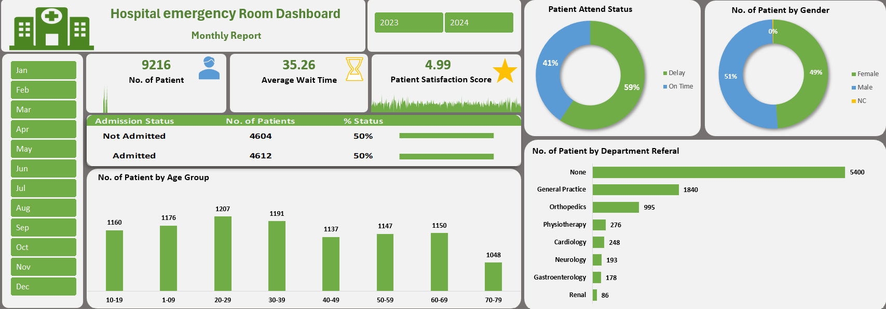

# Hospital Emergency Room Dashboard

## Project Overview

The **Hospital Emergency Room Dashboard** is a healthcare analytics
project that summarizes emergency room activity through key performance
indicators and visualizations. It focuses on patient volume, admission
status, waiting time, satisfaction, demographics, attendance status, and
department referrals.

## Dashboard Preview

## Key Performance Indicators

  Metric                      |   Dashboard Value
  ----------------------------|-----------------
  Total Patients              |           9,216
  Average Wait Time           |             35.26
  Patient Satisfaction Score  |             4.99
  Admitted Patients           |            4,612
  Not Admitted Patients       |            4,604

## Dashboard Features

-   **Admission Status:** Compares admitted and non-admitted patients.
-   **Attendance Status:** Displays delayed versus on-time attendance.
-   **Gender Distribution:** Shows the reported patient distribution by
    gender.
-   **Age Group Analysis:** Compares patient counts across age groups.
-   **Department Referral Analysis:** Highlights referral categories.
-   **Monthly and Year Filters:** Supports filtering the displayed
    results by period.

## Key Observations

-   The dashboard reports 9,216 patients.
-   Admission is shown as approximately evenly split: 4,612 admitted and
    4,604 not admitted.
-   Attendance status is shown as 59% delayed and 41% on time.
-   Gender distribution is shown as 51% male and 49% female, with an
    additional NC category displayed as 0% after rounding.
-   The largest referral category shown is **None**, followed by
    **General Practice** and **Orthopedics**.

## Tools and Skills

-   Microsoft Excel
-   KPI reporting
-   Data visualization
-   Dashboard design
-   Healthcare operational reporting

## Data Privacy

Only publish synthetic, anonymized, or appropriately authorized data. Do
not upload identifiable patient information or confidential medical
records.

## Disclaimer

This project is intended for educational and portfolio demonstration
purposes. Validate dashboard metrics against the underlying dataset
before using them for operational or clinical decisions.

## Author

Abhishek Gupta
